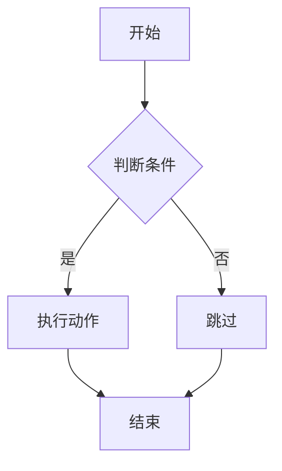
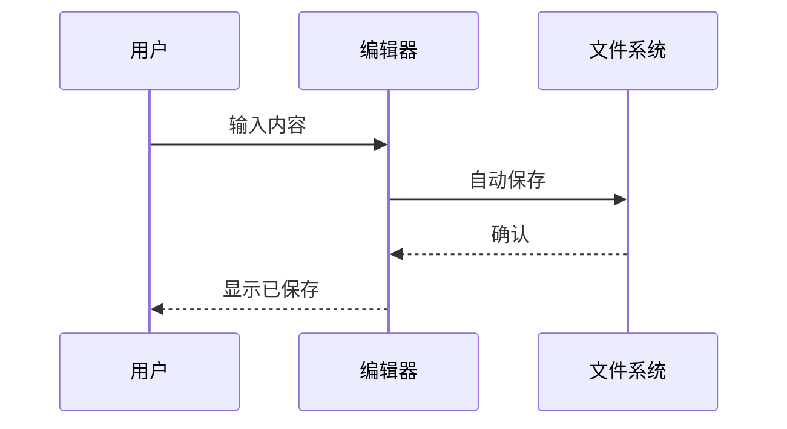
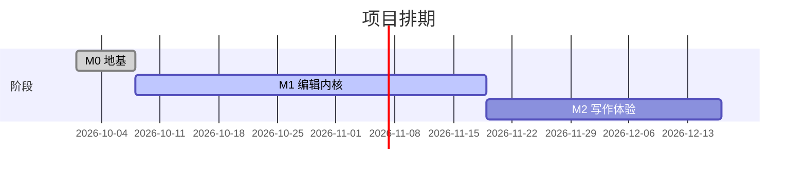

# 数学与图表

## 行内数学

质能方程 $E = mc^2$，欧拉恒等式 $e^{i\pi} + 1 = 0$。

带上下标的公式：$a_1 + a_2 = b_n$。

行内公式里可以有中文：$f(x) = \text{中文测试}$。

## 数学块

$$
\begin{align}
y = y(x,t) &= A e^{i\theta} \\
&= A (\cos \theta + i \sin \theta) \\
&= A\cos(kx - \omega t) + i A\sin(kx - \omega t)
\end{align}
$$

行间公式（单行）：

$$\frac{\partial X}{\partial u} = \frac{\partial Y}{\partial u} = 0$$

带编号的公式：

$$
x + 1 \over \sqrt{1-x^2} \label{ref1} \tag{1}
$$

这是一个引用：$\ref{ref1}$。

## 化学公式

$\ce{CH4 + 2 O2 -> CO2 + 2 H2O}$

## Mermaid 图表

